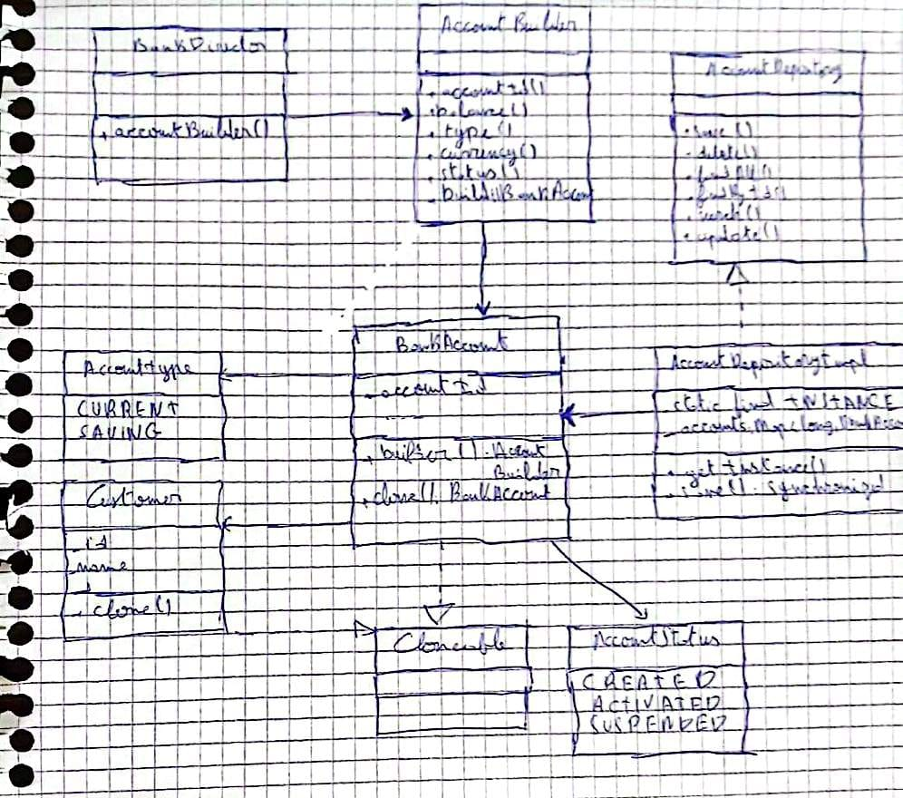
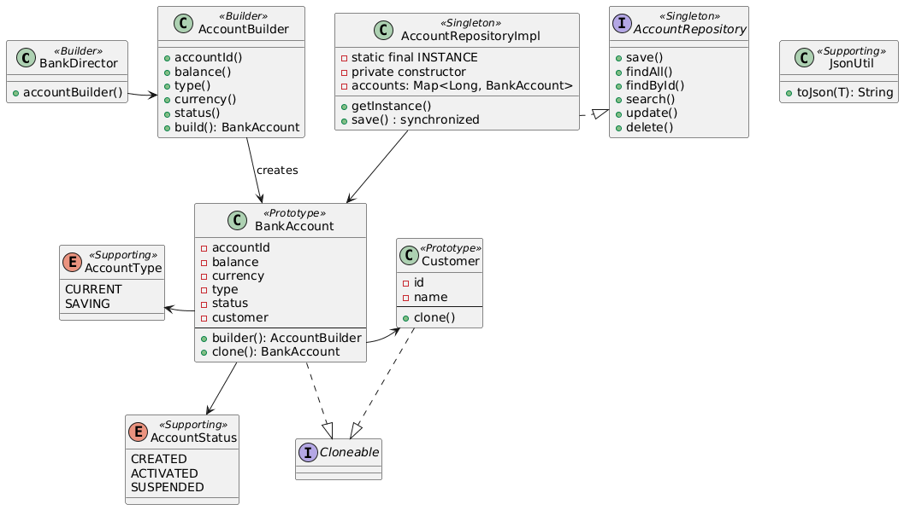
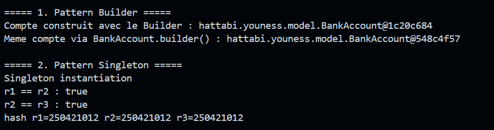
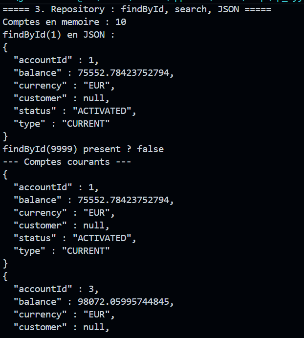
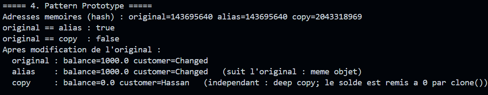
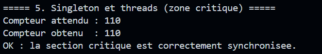

# Rapport de Travaux Pratiques : Design Patterns de création (Builder, Singleton, Prototype) et synchronisation des threads

**Encadrant :** Mohamed YOUSSFI  
**Étudiant :** Youness HATTABI

---

## Table des Matières

1. [Introduction](#1-introduction)
2. [Diagramme de classes](#2-diagramme-de-classes)
3. [Implémentation](#3-implémentation)
   - 3.1 [Le modèle : `AccountType`, `AccountStatus`, `Customer` et `BankAccount`](#31-le-modèle--accounttype-accountstatus-customer-et-bankaccount)
   - 3.2 [Pattern Builder : `AccountBuilder`](#32-pattern-builder--accountbuilder)
   - 3.3 [Le Director : `BankDirector`](#33-le-director--bankdirector)
   - 3.4 [Le repository : `AccountRepository`](#34-le-repository--accountrepository)
   - 3.5 [Pattern Singleton : `AccountRepositoryImpl`](#35-pattern-singleton--accountrepositoryimpl)
   - 3.6 [Synchronisation des threads](#36-synchronisation-des-threads)
   - 3.7 [Pattern Prototype : le clonage](#37-pattern-prototype--le-clonage)
   - 3.8 [Sérialisation JSON : `JsonUtil`](#38-sérialisation-json--jsonutil)
   - 3.9 [La classe `Main`](#39-la-classe-main)
4. [Tests et Résultats](#4-tests-et-résultats)
   - 4.1 [Builder et Singleton](#41-builder-et-singleton)
   - 4.2 [Repository : `Optional`, `Predicate` et JSON](#42-repository--optional-predicate-et-json)
   - 4.3 [Prototype : référence, copie et copie profonde](#43-prototype--référence-copie-et-copie-profonde)
   - 4.4 [Threads : la race condition](#44-threads--la-race-condition)
5. [Pistes d'amélioration](#5-pistes-damélioration)
6. [Conclusion](#6-conclusion)

---

## 1. Introduction

Ce travail consiste à développer une petite application de **gestion de comptes bancaires** en Java afin d'étudier les **patrons de conception de création** (_Creational Design Patterns_). Les patrons de conception se répartissent en trois catégories : **création** (comment instancier les objets), **structure** (comment connecter les classes et les objets) et **comportement** (comment les objets interagissent). Ce TP porte sur la première catégorie.

Les patrons étudiés sont :

- **Builder** : construction pas à pas d'objets complexes grâce à une API fluide, sans constructeur à nombreux paramètres ;
- **Singleton** : garantie qu'une classe n'a qu'**une seule instance** dans l'application ;
- **Prototype** : création d'un objet par **clonage** d'un objet existant, sans passer par `new` et des `get`/`set`.

Le TP rappelle aussi des notions fondamentales de Java :

- `Optional` et `Predicate` pour la recherche multicritère dans le repository ;
- la sérialisation **JSON** avec la bibliothèque **Jackson** ;
- les **threads** et la **synchronisation** (`synchronized`) pour protéger une zone critique, en particulier sur un Singleton partagé.

Le projet est organisé comme un projet Maven (Java 21), avec la racine de packages `hattabi.youness`.

## 2. Diagramme de classes

**Diagramme UML :**



La même structure dans Editeur :



**Organisation du projet :**

```
design-patterns-synthese/
├── pom.xml
└── src/main/java/hattabi/youness/
    ├── Main.java
    ├── builder/
    │   └── BankDirector.java
    ├── model/
    │   ├── AccountStatus.java
    │   ├── AccountType.java
    │   ├── BankAccount.java
    │   └── Customer.java
    ├── repository/
    │   ├── AccountRepository.java
    │   └── AccountRepositoryImpl.java
    └── util/
        └── JsonUtil.java
```

**Dépendance Maven (`pom.xml`) :**

```xml
<properties>
    <maven.compiler.source>21</maven.compiler.source>
    <maven.compiler.target>21</maven.compiler.target>
</properties>
<dependencies>
        <dependency>
            <groupId>tools.jackson.core</groupId>
            <artifactId>jackson-databind</artifactId>
            <version>3.3.0</version>
        </dependency>
</dependencies>
```

---

## 3. Implémentation

### 3.1 Le modèle : `AccountType`, `AccountStatus`, `Customer` et `BankAccount`

Les deux **énumérations** restreignent les valeurs possibles et évitent les fautes de frappe d'une chaîne de caractères.

```java
package hattabi.youness.model;

public enum AccountType { CURRENT, SAVING }

public enum AccountStatus { CREATED, ACTIVATED, SUSPENDED }
```

`Customer` sert à illustrer la différence entre **copie superficielle** et **copie profonde** lors du clonage.

```java
public class Customer implements Cloneable {
    private Long id;
    private String name;

    public Customer(Long id, String name) { this.id = id; this.name = name; }

    @Override
    public Customer clone() {
        try {
            return (Customer) super.clone();
        } catch (CloneNotSupportedException e) {
            throw new RuntimeException(e);
        }
    }
    // getters/setters et toString()
}
```

`BankAccount` possède un identifiant, un solde, une devise, un type, un statut et un client. Les getters, setters, constructeurs et `toString()` sont générés par l'IDE.

```java
public class BankAccount implements Cloneable {
    private Long accountId;
    private double balance;
    private String currency;
    private AccountType type;
    private AccountStatus status;
    private Customer customer;

    public BankAccount() {}

    public BankAccount(Long accountId, double balance, String currency,
                       AccountType type, AccountStatus status) {
        this.accountId = accountId;
        this.balance = balance;
        this.currency = currency;
        this.type = type;
        this.status = status;
    }
    // AccountBuilder, builder(), clone(), getters/setters, toString()
}
```

---

### 3.2 Pattern Builder : `AccountBuilder`

**Problème :** un constructeur avec beaucoup de paramètres est illisible et il est facile d'en inverser l'ordre ; avec des setters, l'objet est construit en plusieurs instructions séparées. Le Builder permet une construction **lisible, chaînée et progressive**.

`AccountBuilder` est une **classe interne statique** de `BankAccount`. Elle détient l'objet en cours de construction. Chaque méthode qui remplit un attribut **retourne le builder lui-même** (`return this`) : c'est l'**astuce du pattern**, qui permet d'enchaîner les appels avec un point.

```java
public static class AccountBuilder {
    private final BankAccount account = new BankAccount();

    public AccountBuilder accountId(Long id)        { account.accountId = id;      return this; }
    public AccountBuilder balance(double balance)   { account.balance = balance;   return this; }
    public AccountBuilder currency(String currency) { account.currency = currency; return this; }
    public AccountBuilder type(AccountType type)    { account.type = type;         return this; }
    public AccountBuilder status(AccountStatus s)   { account.status = s;          return this; }

    public BankAccount build() { return account; }
}

public static AccountBuilder builder() { return new AccountBuilder(); }
```

Utilisation :

```java
BankAccount acc = BankAccount.builder()
        .accountId(1L).balance(5000).currency("MAD")
        .type(AccountType.CURRENT).status(AccountStatus.ACTIVATED)
        .build();
```

---

### 3.3 Le Director : `BankDirector`

Dans le patron complet, les builders sont fabriqués par une classe **Director** plutôt que placés dans la classe construite. Cela permet de proposer plusieurs builders (par exemple un builder de compte courant et un builder de compte épargne). Pour de l'héritage, on utilise un **builder abstrait** (attributs communs) et des **builders concrets** (attributs propres, comme le taux d'intérêt d'un compte épargne).

```java
package hattabi.youness.builder;

public class BankDirector {
    public BankAccount.AccountBuilder accountBuilder() {
        return new BankAccount.AccountBuilder();
    }
}
```

---

### 3.4 Le repository : `AccountRepository`

Le repository simule une couche d'accès aux données **sans base de données**. L'interface expose :

- `findById` qui retourne un `Optional<BankAccount>`, car le compte recherché peut ne pas exister (même convention que Spring Data) ;
- `search` qui prend un `Predicate<BankAccount>`, une interface fonctionnelle dont la méthode `test(account)` retourne `true` ou `false`, ce qui permet une **recherche multicritère** avec des lambdas.

```java
public interface AccountRepository {
    BankAccount save(BankAccount account);
    List<BankAccount> findAll();
    Optional<BankAccount> findById(Long id);
    List<BankAccount> search(Predicate<BankAccount> predicate);
    BankAccount update(BankAccount account);
    void delete(Long id);
}
```

---

### 3.5 Pattern Singleton : `AccountRepositoryImpl`

**Problème :** rien n'empêche d'écrire plusieurs fois `new AccountRepositoryImpl()`, ce qui créerait plusieurs dépôts indépendants. Le Singleton garantit une **instance unique**.

**Recette :**

1. un **constructeur privé**, pour interdire `new` à l'extérieur de la classe ;
2. un attribut **`static final`** du même type, initialisé dans un **bloc statique** exécuté une seule fois, au **chargement de la classe** en mémoire ;
3. une méthode **statique** `getInstance()` qui retourne cette instance.

Les comptes sont stockés dans une `Map<Long, BankAccount>` et un compteur simule l'auto-incrément de la clé primaire.

```java
public class AccountRepositoryImpl implements AccountRepository {

    private static final AccountRepositoryImpl INSTANCE;

    static {
        System.out.println("Singleton instantiation");
        INSTANCE = new AccountRepositoryImpl();
    }

    private final Map<Long, BankAccount> accounts = new HashMap<>();
    private final Object lock = new Object();
    private long accountsCount = 0;

    private AccountRepositoryImpl() {}

    public static AccountRepositoryImpl getInstance() { return INSTANCE; }

    @Override
    public BankAccount save(BankAccount account) {
        synchronized (lock) {                       // zone critique (voir 3.6)
            account.setAccountId(++accountsCount);
            accounts.put(account.getAccountId(), account);
        }
        return account;
    }

    @Override public List<BankAccount> findAll() { return new ArrayList<>(accounts.values()); }

    @Override public Optional<BankAccount> findById(Long id) {
        return Optional.ofNullable(accounts.get(id));
    }

    @Override public List<BankAccount> search(Predicate<BankAccount> p) {
        return accounts.values().stream().filter(p).collect(Collectors.toList());
    }

    @Override public BankAccount update(BankAccount a) { accounts.put(a.getAccountId(), a); return a; }
    @Override public void delete(Long id) { accounts.remove(id); }

    public long getAccountsCount() { return accountsCount; }

    public void populate() {
        BankDirector director = new BankDirector();
        for (int i = 0; i < 10; i++) {
            save(director.accountBuilder()
                    .balance(10000 + Math.random() * 90000)
                    .type(Math.random() > 0.5 ? AccountType.CURRENT : AccountType.SAVING)
                    .status(Math.random() > 0.5 ? AccountStatus.CREATED : AccountStatus.ACTIVATED)
                    .currency(Math.random() > 0.5 ? "MAD" : "USD")
                    .build());
        }
    }
}
```

---

### 3.6 Synchronisation des threads

Un Singleton est **partagé** par tous les threads de l'application. Si plusieurs threads modifient le même attribut, une **race condition** peut se produire.

Exemple bancaire : un solde de 6000 et deux versements simultanés de 3000. Les deux threads lisent 6000 et écrivent 9000, alors que le résultat correct est 12000.

**Solution : bloc `synchronized`** sur la seule zone critique (retenue ici). Le premier thread verrouille l'objet, les autres attendent à l'entrée du bloc ; le reste de la méthode reste exécutable en parallèle.

```java
synchronized (lock) {
    account.setAccountId(++accountsCount);
    accounts.put(account.getAccountId(), account);
}
```

---

### 3.7 Pattern Prototype : le clonage

**Problème :** pour dupliquer un objet, la méthode « classique » consiste à faire `new` puis à recopier chaque attribut avec `get`/`set`. C'est lent et fastidieux. Le pattern **Prototype** crée une copie directement **en mémoire**, comme un copier-coller dans un logiciel de dessin.

En Java :

1. la classe implémente l'interface `Cloneable` (sinon `CloneNotSupportedException` est levée) ;
2. elle **redéfinit** `clone()`, qui est `protected` dans `Object`, en la rendant `public` et en précisant le type de retour ;
3. elle appelle `super.clone()`, qui duplique l'objet.

```java
@Override
public BankAccount clone() {
    try {
        BankAccount copy = (BankAccount) super.clone();
        copy.setBalance(0);                                   // attribut volontairement non copié
        if (this.customer != null) {
            copy.setCustomer(this.customer.clone());          // copie profonde
        }
        return copy;
    } catch (CloneNotSupportedException e) {
        throw new RuntimeException(e);
    }
}
```

---

### 3.8 Sérialisation JSON : `JsonUtil`

Une méthode générique `toJson` utilise `ObjectMapper` de Jackson pour afficher n'importe quel objet en JSON formaté. L'exception contrôlée est convertie en exception non contrôlée pour ne pas alourdir les appelants.

```java
package hattabi.youness.util;

public class JsonUtil {
    private static final ObjectMapper MAPPER = new ObjectMapper();

    public static <T> String toJson(T object) {
        try {
            return MAPPER.writerWithDefaultPrettyPrinter().writeValueAsString(object);
        } catch (JsonProcessingException e) {
            throw new RuntimeException(e);
        }
    }
}
```

---

### 3.9 La classe `Main`

`Main` enchaîne cinq démonstrations :

1. **Builder** : construction d'un compte via le `BankDirector` puis via `BankAccount.builder()` ;
2. **Singleton** : trois appels à `getInstance()` et comparaison des références avec `==` ; le message d'instanciation ne doit apparaître qu'une fois ;
3. **Repository** : `populate()`, `findById` (avec `Optional`), `search` avec deux `Predicate`, `delete`, et affichage en JSON ;
4. **Prototype** : alias contre clone, puis modification de l'original pour prouver l'indépendance de la copie profonde ;
5. **Threads** : 10 threads appellent `populate()` sur le même Singleton ; le compteur final doit valoir exactement `avant + 10 × 10`.

```java
package hattabi.youness;

import hattabi.youness.builder.BankDirector;
import hattabi.youness.model.AccountStatus;
import hattabi.youness.model.AccountType;
import hattabi.youness.model.BankAccount;
import hattabi.youness.model.Customer;
import hattabi.youness.repository.AccountRepositoryImpl;
import hattabi.youness.util.JsonUtil;

import java.util.ArrayList;
import java.util.List;

public class Main {

    private static final int THREADS = 10;
    private static final int ACCOUNTS_PER_POPULATE = 10;

    public static void main(String[] args) throws InterruptedException {
        demoBuilder();
        AccountRepositoryImpl repo = demoSingleton();
        demoRepository(repo);
        demoPrototype();
        demoConcurrency(repo);
    }

    private static void demoBuilder() {
        section("1. Pattern Builder");
        BankDirector director = new BankDirector();
        BankAccount account = director.accountBuilder()
                .accountId(0L).balance(5000).currency("MAD")
                .type(AccountType.CURRENT).status(AccountStatus.ACTIVATED)
                .build();
        System.out.println("Compte construit avec le Builder : " + account);
        System.out.println("Meme compte via BankAccount.builder() : "
                + BankAccount.builder().balance(100).currency("USD").build());
    }

    private static AccountRepositoryImpl demoSingleton() {
        section("2. Pattern Singleton");
        AccountRepositoryImpl r1 = AccountRepositoryImpl.getInstance();
        AccountRepositoryImpl r2 = AccountRepositoryImpl.getInstance();
        AccountRepositoryImpl r3 = AccountRepositoryImpl.getInstance();
        System.out.println("r1 == r2 : " + (r1 == r2));
        System.out.println("r2 == r3 : " + (r2 == r3));
        System.out.println("hash r1=" + System.identityHashCode(r1)
                + " r2=" + System.identityHashCode(r2)
                + " r3=" + System.identityHashCode(r3));
        return r1;
    }

    private static void demoRepository(AccountRepositoryImpl repo) {
        section("3. Repository : findById, search, JSON");
        repo.populate();
        System.out.println("Comptes en memoire : " + repo.findAll().size());
        System.out.println(repo.findById(1L).map(JsonUtil::toJson).orElse("introuvable"));
        System.out.println("findById(9999) present ? " + repo.findById(9999L).isPresent());

        System.out.println("--- Comptes courants ---");
        repo.search(a -> a.getType() == AccountType.CURRENT)
                .forEach(a -> System.out.println(JsonUtil.toJson(a)));

        System.out.println("--- Comptes courants ET actives ---");
        repo.search(a -> a.getType() == AccountType.CURRENT
                && a.getStatus() == AccountStatus.ACTIVATED)
                .forEach(a -> System.out.println(JsonUtil.toJson(a)));

        repo.delete(1L);
        System.out.println("Apres delete(1) -> findById(1) present ? "
                + repo.findById(1L).isPresent());
    }

    private static void demoPrototype() {
        section("4. Pattern Prototype");
        BankAccount original = new BankDirector().accountBuilder()
                .accountId(100L).balance(8000).currency("MAD")
                .type(AccountType.SAVING).status(AccountStatus.ACTIVATED)
                .build();
        original.setCustomer(new Customer(1L, "Hassan"));

        BankAccount alias = original;          // meme objet, autre reference
        BankAccount copy = original.clone();   // objet distinct en memoire

        System.out.println("original == alias : " + (original == alias));
        System.out.println("original == copy  : " + (original == copy));

        original.setBalance(1000);
        original.getCustomer().setName("Changed");

        System.out.println("  original : balance=" + original.getBalance()
                + " customer=" + original.getCustomer().getName());
        System.out.println("  alias    : balance=" + alias.getBalance()
                + " customer=" + alias.getCustomer().getName());
        System.out.println("  copy     : balance=" + copy.getBalance()
                + " customer=" + copy.getCustomer().getName());
    }

    private static void demoConcurrency(AccountRepositoryImpl repo) throws InterruptedException {
        section("5. Singleton et threads (zone critique)");
        long before = repo.getAccountsCount();
        List<Thread> threads = new ArrayList<>();

        for (int i = 0; i < THREADS; i++) {
            Thread t = new Thread(repo::populate, "worker-" + i);
            threads.add(t);
            t.start();                         // non bloquant : execution parallele
        }
        for (Thread t : threads) t.join();     // attendre la fin de tous les threads

        long expected = before + (long) THREADS * ACCOUNTS_PER_POPULATE;
        long actual = repo.getAccountsCount();
        System.out.println("Compteur attendu : " + expected);
        System.out.println("Compteur obtenu  : " + actual);
        System.out.println(actual == expected
                ? "OK : la section critique est correctement synchronisee."
                : "ERREUR : race condition detectee (incrementations perdues).");
    }

    private static void section(String title) {
        System.out.println();
        System.out.println("===== " + title + " =====");
    }
}
```

---

## 4. Tests et Résultats

### 4.1 Builder et Singleton

Sortie attendue:

```
===== 1. Pattern Builder =====
Compte construit avec le Builder : BankAccount{accountId=0, balance=5000.0, currency='MAD', type=CURRENT, status=ACTIVATED}
Meme compte via BankAccount.builder() : BankAccount{accountId=null, balance=100.0, currency='USD', type=null, status=null}

===== 2. Pattern Singleton =====
Singleton instantiation
r1 == r2 : true
r2 == r3 : true
hash r1=... r2=... r3=...
```

Le message `Singleton instantiation` n'est affiché qu'**une seule fois**, bien que `getInstance()` soit appelé trois fois : le bloc statique n'est exécuté qu'au chargement de la classe. Les trois variables ont le même hash d'identité, ce qui prouve qu'elles référencent le même objet.

**Capture :**



---

### 4.2 Repository : `Optional`, `Predicate` et JSON

- `populate()` crée 10 comptes, donc `findAll().size()` vaut 10 ;
- `findById(1L)` retourne le compte en JSON formaté, tandis que `findById(9999L).isPresent()` vaut `false` : l'`Optional` vide évite un `NullPointerException` ;
- le premier `search` ne retourne que les comptes `CURRENT`, le second ceux qui sont à la fois `CURRENT` et `ACTIVATED` : les critères se composent avec `&&` ;
- après `delete(1L)`, `findById(1L).isPresent()` vaut `false`.

Exemple de compte affiché :

```json
{
  "accountId": 1,
  "balance": 53821.4,
  "currency": "MAD",
  "type": "CURRENT",
  "status": "ACTIVATED",
  "customer": null
}
```

**Capture :**



---

### 4.3 Prototype : référence, copie et copie profonde

```
original == alias : true
original == copy  : false
  original : balance=1000.0 customer=Changed
  alias    : balance=1000.0 customer=Changed
  copy     : balance=0.0 customer=Hassan
```

- `original == alias` est vrai : un alias n'est qu'une seconde référence ;
- `original == copy` est faux : `clone()` a créé un objet distinct en mémoire ;
- après modification de l'original, l'alias **suit** (même objet), alors que la copie **conserve** le nom `Hassan` : la **copie profonde** du `Customer` fonctionne. Sans `this.customer.clone()`, la copie afficherait aussi `Changed` ;
- le solde de la copie vaut `0.0` car `clone()` le réinitialise volontairement.

**Capture :**



---

### 4.4 Threads : la race condition

Avec le bloc `synchronized`, le résultat est toujours exact :

```
Compteur attendu : 110
Compteur obtenu  : 110
OK : la section critique est correctement synchronisee.
```

**Captures :**



---

## 6. Conclusion

Ce travail a permis d'implémenter trois patrons de conception de création dans une même application : le **Builder** rend la construction d'objets lisible et chaînable, le **Singleton** garantit une instance unique du repository, et le **Prototype** duplique rapidement des objets, à condition de gérer la **copie profonde** des attributs de type objet. L'étude du Singleton dans un environnement **multithread** a aussi montré qu'un état partagé doit être protégé : sans synchronisation, l'incrémentation du compteur perd des mises à jour de façon intermittente, alors qu'un bloc `synchronized` limité à la zone critique corrige le défaut en conservant le parallélisme du reste du code. Comprendre ces mécanismes à la main permet ensuite d'utiliser en connaissance de cause les frameworks (Lombok, Spring) qui les automatisent.
